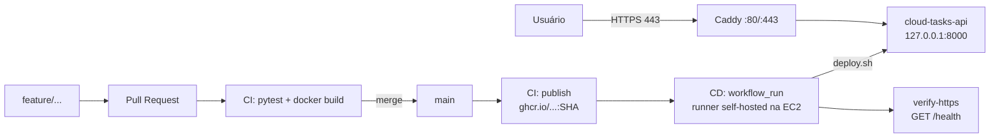

# Cloud Tasks API — Projeto Final de Computação em Nuvem

API Flask/SQLite de tarefas usada como objeto de uma **esteira completa de CI/CD**: testes e build no GitHub Actions, imagem Docker versionada por SHA no GitHub Container Registry (GHCR) e entrega contínua em AWS EC2 com verificação de `/health` via HTTPS.

> **Situação:** esteira completa em funcionamento — CI em PRs, publicação no GHCR por SHA, CD automático na EC2 com health check, persistência comprovada e rollback automático. Aplicação: <https://32-193-56-180.sslip.io/health> (disponível enquanto a infraestrutura estiver ativa).

## Integrantes e responsabilidades

| Integrante | Matrícula | Itens do [TODO](TODO.md) |
|---|---|---|
| João Vitor Jardim Machado Pontes | 22307063 | 1 (preparação e repositório), 2 (evolução da API: `DELETE /tasks/<id>`, melhoria `PATCH` de título e testes) e 8 (documentação, evidências e apresentação) |
| Elter Rodrigues | 22309480 | 4 (CI no GitHub Actions), 5 (publicação versionada no GHCR), parte do 6 (robustez do workflow de CD — PR #2) e parte do 8 (documentação) |
| Gabriel Duarte Marques | 22303292 | 3 (EC2, rede e segurança), 6 (CD: runner auto-hospedado e deploy na EC2), 7 (validação, nova versão e persistência) e 11 (bônus: TLS, observabilidade e rollback) |

## Objetivos e requisitos acadêmicos

Fluxo exigido pelo [enunciado](ENUNCIADO_ALUNOS.md): branch `feature/...` → Pull Request → CI → merge na `main` → imagem no GHCR (tag = SHA) → CD na EC2 → `GET /health`. Também são exigidos: Security Group documentado e SSH restrito (sem `0.0.0.0/0`), secrets fora do código/logs, `DELETE /tasks/<id>` e mais uma melhoria com testes, persistência após recriar o contêiner e encerramento dos recursos AWS. O acompanhamento item a item está em [TODO.md](TODO.md).

## Tecnologias

| Camada | Tecnologia |
|---|---|
| API | Python 3.12, Flask 3, SQLite, Gunicorn |
| Testes | pytest |
| Contêiner | Docker (`python:3.12-slim`, usuário sem privilégios), Docker Compose (uso local) |
| CI/CD | GitHub Actions (`ci.yml`, `cd.yml`) com runner auto-hospedado na EC2 |
| Registry | GitHub Container Registry — `ghcr.io/jpontesdev/computacao-em-nuvem` |
| Nuvem | AWS EC2 `t3.micro` (us-east-1), Amazon Linux 2023, IP elástico, Caddy (HTTPS), CloudWatch + SNS |

## Arquitetura



Detalhes no [relatório técnico](docs/RELATORIO_FINAL.md).

## Estrutura de diretórios

```text
.github/workflows/ci.yml   # testes, build e publicação no GHCR
.github/workflows/cd.yml   # deploy na EC2 (runner self-hosted) + verificação HTTPS
app/main.py                # API Flask + SQLite
app/wsgi.py                # entrada do Gunicorn
tests/test_api.py          # testes pytest
scripts/deploy.sh          # deploy com health check e rollback automático
scripts/setup-ec2-ubuntu.sh# instalação de Docker (guia original, Ubuntu)
docs/CONFIGURACAO.md       # guia AWS + GitHub
docs/RELATORIO_FINAL.md    # relatório técnico
docs/ROTEIRO_APRESENTACAO.md
docs/evidencias/           # capturas de tela (EC2, SG, deploy, persistência, rollback) e vídeo de demonstração
Dockerfile, compose.yaml, requirements.txt, requirements-dev.txt, pytest.ini
```

## Execução local

```bash
python -m venv .venv
# Linux/macOS: source .venv/bin/activate  |  Windows: .venv\Scripts\activate
pip install -r requirements-dev.txt
python -m flask --app app.main run --port 5000
```

Sem `DB_PATH` definido, o banco fica em `/tmp/cloud_tasks.db`. No Windows, defina `DB_PATH` para um caminho existente (ex.: `set DB_PATH=%TEMP%\tasks.db` no cmd ou `$env:DB_PATH="$env:TEMP\tasks.db"` no PowerShell). A tabela `tasks` é criada automaticamente na inicialização.

### Variáveis de ambiente

| Variável | Onde | Padrão | Função |
|---|---|---|---|
| `DB_PATH` | API | `/tmp/cloud_tasks.db` (imagem Docker: `/data/tasks.db`) | Caminho do banco SQLite |
| `APP_NAME` | `deploy.sh` | `cloud-tasks-api` | Nome do contêiner da API |
| `DATA_VOLUME` | `deploy.sh` | `cloud-tasks-data` | Volume nomeado com o banco |
| `DOCKER_NETWORK` | `deploy.sh` | `cloud-tasks-net` | Rede Docker compartilhada com o Caddy (deve existir) |
| `PUBLISH` | `deploy.sh` | `127.0.0.1:8000:8000` | Publicação de porta (apenas loopback) |
| `HEALTH_URL` | `deploy.sh` | `http://127.0.0.1:8000/health` | URL do health check local |

As variáveis do `deploy.sh` podem ser sobrescritas em `~/.cloud-tasks.env` na EC2 (permissão 600, fora do repositório).

### Testes

```bash
python -m pytest -q
```

Os testes usam um banco temporário por teste (`tmp_path`) e também rodam na CI a cada PR. São 14 casos em [tests/test_api.py](tests/test_api.py), cobrindo `/health`, criação/listagem, validação de título, conclusão, edição de título (inclusive combinada com `done` e títulos inválidos), `404` em tarefas inexistentes e `DELETE` (`204`, `404` e exclusão repetida).

### Docker

```bash
docker compose up --build
curl http://localhost:8080/health
```

O Compose mapeia `8080 → 8000` e guarda o banco no volume `task_data` (`DB_PATH=/data/tasks.db`).

## API

| Método | Rota | Função |
|---|---|---|
| GET | `/` | Informações do serviço |
| GET | `/health` | Saúde da aplicação/banco (200 ou 503) |
| GET | `/tasks` | Lista tarefas |
| POST | `/tasks` | Cria tarefa (`{"title":"..."}`, até 120 caracteres) |
| PATCH | `/tasks/<id>` | Atualiza título e/ou conclusão (`{"title":"..."}`, `{"done":true}`) — **melhoria** |
| DELETE | `/tasks/<id>` | Remove tarefa (`204` se removida, `404` se inexistente) |

**Regras de validação e respostas**

| Situação | Resposta |
|---|---|
| Tarefa criada | `201` com `{"id":1,"title":"Minha tarefa","done":false}` |
| Tarefa atualizada | `200` com a tarefa completa |
| `title` ausente, vazio, só espaços, não-texto ou com mais de 120 caracteres | `400` com `{"error":"..."}` (o título é salvo sem espaços nas pontas) |
| `PATCH` sem `title` nem `done`, ou `done` não booleano | `400` |
| `PATCH`/`DELETE` em id inexistente | `404` com `{"error":"tarefa nao encontrada"}` |
| Banco inacessível em `/health` | `503` com `{"status":"error"}` |

```bash
BASE=https://32-193-56-180.sslip.io   # ou http://localhost:8080 com Docker Compose
curl $BASE/health
curl -X POST $BASE/tasks -H 'Content-Type: application/json' -d '{"title":"Minha tarefa"}'
curl $BASE/tasks
curl -X PATCH $BASE/tasks/1 -H 'Content-Type: application/json' -d '{"title":"Novo título","done":true}'
curl -X DELETE -i $BASE/tasks/1
```

## CI em Pull Requests

[`ci.yml`](.github/workflows/ci.yml) roda em `pull_request` e `push` para `main`:

| Job | PR | Push na `main` |
|---|---|---|
| `test` — instala dependências (cache pip) e roda `pytest` | ✅ | ✅ |
| `build` — `docker build` sem login e sem push | ✅ | ✅ |
| `publish` — login no GHCR e push da imagem | ignorado | ✅ |

PRs nunca recebem `packages: write`, nunca publicam imagem e não disparam o CD.

## Publicação no GHCR

Após push na `main`, o job `publish` publica `ghcr.io/jpontesdev/computacao-em-nuvem:<SHA completo do commit>`. A tag é imutável e identifica exatamente o código implantado. O pacote é público, permitindo `docker pull` na EC2 sem credenciais.

## CD na EC2

[`cd.yml`](.github/workflows/cd.yml) é disparado por `workflow_run` quando a CI termina e só executa se **todas** as condições valerem: `DEPLOY_ENABLED == 'true'`; CI concluída com sucesso, originada de `push` na `main` do próprio repositório.

1. **`deploy`** — roda no runner auto-hospedado da EC2 (`[self-hosted, linux, x64, deploy-ec2]`). Ignora o deploy se o SHA não for mais o topo da `main` e executa [`deploy.sh`](scripts/deploy.sh): `docker pull` da imagem por SHA → preserva o contêiner atual como `-previous` → sobe a nova versão no mesmo volume → health check local. Se o health check falhar, **restaura automaticamente** a versão anterior.
2. **`verify-https`** — roda em runner hospedado do GitHub e checa `https://<APP_URL>/health` de fora da EC2, com tentativas e timeout limitados.

Como o runner se conecta ao GitHub apenas por conexão de saída, o deploy **não precisa de SSH de entrada**. Deploys são serializados (`concurrency`) e limitados a 15 min.

**Configuração no GitHub** (Settings → Secrets and variables → Actions, detalhes em [CONFIGURACAO.md](docs/CONFIGURACAO.md)):

| Nome | Tipo | Função |
|---|---|---|
| `DEPLOY_ENABLED` | Variable (repositório) | Interruptor do CD; só implanta com `true` |
| `APP_URL` | Variable | URL HTTPS pública usada no `verify-https` (ex.: `https://32-193-56-180.sslip.io`) |
| `GITHUB_TOKEN` | Automático | Login/push no GHCR (somente no job `publish`) |

Também é necessário o environment `production` e um runner auto-hospedado com o rótulo `deploy-ec2`.

**Deploy manual na EC2** (mesmo script usado pelo CD; aceita apenas imagens deste repositório com SHA completo de 40 caracteres):

```bash
docker network create cloud-tasks-net   # apenas na primeira vez
bash scripts/deploy.sh ghcr.io/jpontesdev/computacao-em-nuvem:<SHA>
```

Se existir um contêiner `cloud-tasks-api-previous` (rollback pendente), o script recusa o deploy até que ele seja resolvido.

## Infraestrutura e Security Group

EC2 `t3.micro` (Amazon Linux 2023, us-east-1) com IP elástico `32.193.56.180` e domínio `32-193-56-180.sslip.io`. O Caddy (`caddy:2`) termina o TLS em 80/443 e encaminha para a API, que só escuta em `127.0.0.1:8000` na rede Docker `cloud-tasks-net`.

| Direção | Porta | Origem/Destino | Justificativa |
|---|---|---|---|
| Entrada | TCP 22 (SSH) | Um único IP `/32` do administrador | Administração manual — **nunca `0.0.0.0/0`** |
| Entrada | TCP 80 (HTTP) | `0.0.0.0/0` | Redirecionamento do Caddy para HTTPS |
| Entrada | TCP 443 (HTTPS) | `0.0.0.0/0` | Acesso público à API |
| Saída | Todas | `0.0.0.0/0` | Runner (saída ao GitHub) e `docker pull` do GHCR |

## Bônus: TLS, observabilidade e rollback

- **TLS:** HTTPS automático com Caddy + `sslip.io`, sem necessidade de domínio próprio.
- **Observabilidade:** alarme CloudWatch em `StatusCheckFailed` notificando por e-mail via tópico SNS `cloud-tasks-alertas` (evidências 15–16).
- **Rollback automático:** o `deploy.sh` mantém a versão anterior até a nova passar no health check; em caso de falha, restaura e revalida a anterior (evidências 17–20).

## Persistência de dados

O banco SQLite fica em `/data/tasks.db`, montado no volume nomeado `cloud-tasks-data`. A cada deploy o contêiner é recriado com a nova imagem, mas o volume é preservado. **Comprovado na EC2:** a tarefa criada com a imagem `ccd2664` continuou listada após o CD #14 recriar o contêiner com a imagem `d8238ad` (evidências 11–14 em [docs/evidencias](docs/evidencias/)).

## Links

- Repositório: <https://github.com/jpontesdev/Computacao-em-Nuvem>
- Aplicação: <https://32-193-56-180.sslip.io/health>
- Pull Requests: [#1 — CI](https://github.com/jpontesdev/Computacao-em-Nuvem/pull/1) · [#2 — CD](https://github.com/jpontesdev/Computacao-em-Nuvem/pull/2) · [#3 — documentação](https://github.com/jpontesdev/Computacao-em-Nuvem/pull/3)
- CI aprovada em PR: [run #4](https://github.com/jpontesdev/Computacao-em-Nuvem/actions/runs/43163185365) · CI aprovada na `main` com publish: [run #17](https://github.com/jpontesdev/Computacao-em-Nuvem/actions/runs/43424541858)
- CD aprovado: [run #14](https://github.com/jpontesdev/Computacao-em-Nuvem/actions/runs/43424701915) · [run #16](https://github.com/jpontesdev/Computacao-em-Nuvem/actions/runs/43431044247)
- Relatório técnico: [docs/RELATORIO_FINAL.md](docs/RELATORIO_FINAL.md) · Roteiro: [docs/ROTEIRO_APRESENTACAO.md](docs/ROTEIRO_APRESENTACAO.md)
- Vídeo de demonstração: [docs/evidencias/VIDEO_DE_DEMOSTRACAO_comp_nuvem.mp4](docs/evidencias/VIDEO_DE_DEMOSTRACAO_comp_nuvem.mp4)

## Situação atual e pendências

| Etapa | Situação |
|---|---|
| CI em PRs (test + build, sem publish) | ✅ PRs #1, #2 e #3 |
| Publicação no GHCR por SHA | ✅ |
| `DELETE /tasks/<id>` + melhoria (`PATCH` de título) + testes | ✅ |
| EC2, Security Group (SSH restrito a um IP `/32`), IP elástico e HTTPS | ✅ |
| CD automático + `/health` local e HTTPS externo | ✅ CD #13–#16 |
| Persistência após recriar o contêiner | ✅ |
| Bônus: domínio/TLS, observabilidade (CloudWatch/SNS), rollback automático | ✅ |
| Gravação do vídeo / demonstração | ✅ [VIDEO_DE_DEMOSTRACAO_comp_nuvem.mp4](docs/evidencias/VIDEO_DE_DEMOSTRACAO_comp_nuvem.mp4) |
| Registro do custo efetivo e encerramento dos recursos AWS | ⏳ Após a apresentação |

## Segurança e limitações

- **Segurança:** nenhuma chave, token ou dado real versionado (`.gitignore` bloqueia `*.pem`, `*.key`, `.env` e `*.db`); contêiner roda com usuário sem privilégios; API exposta apenas via Caddy/HTTPS; SSH restrito a um IP `/32`; deploy por runner auto-hospedado, sem SSH de entrada; PRs não recebem `packages: write` nem disparam CD; o `deploy.sh` valida a referência da imagem antes de executá-la.
- **Limitações:** deploy didático em instância única, sem balanceamento nem alta disponibilidade; há alguns segundos de indisponibilidade na troca do contêiner; SQLite não é adequado a múltiplas instâncias; a API não tem autenticação — não usar dados reais. O grupo `docker` na EC2 equivale a privilégios de root.
