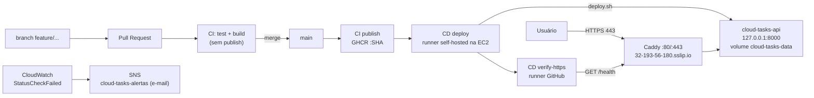

# Relatório técnico — Esteira CI/CD da Cloud Tasks API

**Disciplina:** Computação em Nuvem · **Repositório:** <https://github.com/jpontesdev/Computacao-em-Nuvem> · **Imagem:** `ghcr.io/jpontesdev/computacao-em-nuvem` · **Aplicação:** <https://32-193-56-180.sslip.io/health>

## 1. Introdução

O objetivo é transformar uma API Python que funciona localmente em um serviço entregue automaticamente na nuvem: cada mudança passa por Pull Request e testes, gera uma imagem Docker imutável identificada pelo SHA do commit e, quando integrada à `main`, é implantada em uma instância AWS EC2 com verificação de saúde.

A **Cloud Tasks API** (Flask + SQLite, servida por Gunicorn) oferece `GET /`, `GET /health` (testa o banco; 200 ou 503), `GET /tasks`, `POST /tasks`, `PATCH /tasks/<id>` e `DELETE /tasks/<id>`. A evolução funcional do grupo foi o `DELETE` (204/404, 3 testes) e, como melhoria, a edição do título via `PATCH` (6 testes, incluindo validação e 404).

## 2. Arquitetura

## 3. Infraestrutura, portas e segurança

| Componente | Configuração |
|---|---|
| EC2 | `computacao-nuvem-trab`, `t3.micro`, us-east-1, **Amazon Linux 2023**, EBS raiz 8 GiB (sem criptografia) |
| Rede | IP elástico `32.193.56.180`; domínio `32-193-56-180.sslip.io` (DNS que resolve o próprio IP) |
| Docker | 25.0.14; `ec2-user` no grupo `docker`; rede bridge `cloud-tasks-net` compartilhada por Caddy e API |
| Caddy | Contêiner `caddy:2`, portas 80/443 (TCP e UDP/HTTP3); HTTPS automático e redirecionamento HTTP → HTTPS |
| API | Contêiner `cloud-tasks-api`, publicado só em `127.0.0.1:8000` (não exposto diretamente à internet) |
| Runner | GitHub Actions auto-hospedado, serviço systemd executado como `ec2-user`, rótulo `deploy-ec2` |

**Security Group**

| Direção | Tipo | Porta | Origem/Destino | Justificativa |
|---|---|---|---|---|
| Entrada | SSH | TCP 22 | Um único IP `/32` do administrador | Administração manual; **nunca `0.0.0.0/0`** |
| Entrada | HTTP | TCP 80 | `0.0.0.0/0` | Redirecionamento automático do Caddy para HTTPS |
| Entrada | HTTPS | TCP 443 | `0.0.0.0/0` | Acesso público à API |
| Saída | Todo o tráfego | Todas | `0.0.0.0/0` | Runner (conexão de saída ao GitHub), `docker pull` do GHCR |

**Acesso do deploy:** o runner hospedado do GitHub não tem IP fixo. Em vez de abrir SSH, o deploy roda num **runner auto-hospedado na própria EC2**, que só faz conexões de saída ao GitHub. Assim, nenhuma porta de entrada adicional é necessária.

**Variáveis e segredos:** o CD usa apenas as variables `DEPLOY_ENABLED` (interruptor) e `APP_URL` (URL HTTPS validada por regex), além do `GITHUB_TOKEN` efêmero na CI. Configurações da instância ficam em `~/.cloud-tasks.env` (permissão 600), fora do repositório. Nenhuma chave, token ou dado real é versionado.

## 4. Esteira e resultados

| Etapa | Evidência | Link |
|---|---|---|
| CI em PR (`feature/ci`) | `test` e `build` aprovados; `publish` ignorado | [PR #1](https://github.com/jpontesdev/Computacao-em-Nuvem/pull/1) · [run #4](https://github.com/jpontesdev/Computacao-em-Nuvem/actions/runs/43163185365) |
| CI em PRs seguintes | Aprovadas | [PR #2](https://github.com/jpontesdev/Computacao-em-Nuvem/pull/2) · [PR #3](https://github.com/jpontesdev/Computacao-em-Nuvem/pull/3) |
| Publicação no GHCR | Imagem com tag = SHA após push na `main` | [CI #17](https://github.com/jpontesdev/Computacao-em-Nuvem/actions/runs/43424541858) (`d8238ad`) |
| CD na EC2 | `deploy` + `verify-https` aprovados | [CD #13](https://github.com/jpontesdev/Computacao-em-Nuvem/actions/runs/43421523641) · [#14](https://github.com/jpontesdev/Computacao-em-Nuvem/actions/runs/43424701915) · [#15](https://github.com/jpontesdev/Computacao-em-Nuvem/actions/runs/43428664174) · [#16](https://github.com/jpontesdev/Computacao-em-Nuvem/actions/runs/43431044247) |
| `/health` remoto | `HTTP/2 200`, `{"status":"ok"}`, `server: gunicorn`, `via: 1.1 Caddy` | evidência 10 |

**Nova versão pela esteira:** o CD #13 implantou `ccd2664` e o CD #14 implantou `d8238ad` automaticamente após cada merge na `main`.

**Rollback automático (bônus):** `deploy.sh` mantém o contêiner anterior como `cloud-tasks-api-previous` até a nova versão passar no health check; se falhar, remove a nova e restaura a anterior. Teste isolado (contêiner `cloud-tasks-api-test`, porta 18000, volume próprio), com falha forçada (`SIMULATE_FAILURE=1`): a saída foi *"Nova versão não passou no health check… Rollback concluído e validado."* (código de saída 1). O contêiner restaurado mantinha o mesmo ID anterior (`654fcaec…`) e a tarefa criada. A produção continuou respondendo 200 (evidências 17–20).

**Observabilidade (bônus):** alarme CloudWatch em `AWS/EC2 StatusCheckFailed` (máximo ≥ 1 em 2 de 2 períodos de 5 min) notificando por e-mail o tópico SNS `cloud-tasks-alertas` (evidências 15–16).

## 5. Persistência

O SQLite fica em `/data/tasks.db`, no volume nomeado `cloud-tasks-data`. A cada deploy o contêiner é substituído, mas o volume é reaproveitado.

| Passo | Registro na EC2 (13/11/2026) |
|---|---|
| Volume | `docker volume inspect cloud-tasks-data` → criado em `2026-11-13T12:08:13Z`, driver `local` |
| Antes | `POST /tasks` (12:17 GMT) → `201`, `{"id":1,"title":"Persistencia antes do redeploy","done":false}`; contêiner `df02b251…`, imagem `:ccd2664…` |
| Recriação | Merge na `main` → CI #17 → CD #14 recria o contêiner pela esteira |
| Depois | Contêiner `44ffd58c…`, imagem `:d8238ad…`; `GET /tasks` → mesma tarefa `id 1` |

Os dados só se perdem se o volume ou o disco da instância forem removidos (evidências 11–14).

## 6. Custos e recursos

| Recurso | Detalhe |
|---|---|
| EC2 | 1× `t3.micro`, us-east-1, Amazon Linux 2023 — `i-091df571945cd8ff1` |
| EBS | 1 volume raiz de 8 GiB (`vol-0ee5d7ca913a3b77c`) |
| IP elástico | `32.193.56.180` associado à instância |
| CloudWatch / SNS | 1 alarme + 1 tópico com assinatura por e-mail |
| GitHub | Actions (runners hospedados + 1 auto-hospedado) e GHCR público — sem custo AWS |
| Período | Início em 12/11/2026 (associação do EBS às 12:48 BRT); término após a apresentação |
| Custo efetivo | **Pendente** — registrar o valor do Billing/Cost Explorer após o encerramento |
| Encerramento | **Pendente** — encerrar instância, excluir EBS, liberar IP elástico, remover alarme/tópico e o runner do repositório; anexar evidência |

## 7. Dificuldades e soluções

| Dificuldade | Solução adotada |
|---|---|
| Runner hospedado do GitHub sem IP fixo vs. SSH restrito | Runner auto-hospedado na EC2 (só conexões de saída); SSH apenas do IP `/32` do administrador |
| CD criado antes da infraestrutura existir | Interruptor `DEPLOY_ENABLED`: o CD foi ignorado sem falhar até a EC2 ficar pronta |
| HTTPS sem domínio próprio | `sslip.io` resolvendo o IP elástico + Caddy com certificado automático |
| IP público muda ao reiniciar a instância | IP elástico associado |
| Risco de rollback indevido se a limpeza do contêiner anterior falhasse após um deploy saudável | Trap de rollback desativado logo após o health check; falha de limpeza apenas reportada (commit `5e333c3`) |
| Computador da faculdade sem Docker | Build validado pelo job `build` da CI em cada PR |
| Créditos AWS limitados | Infraestrutura provisionada apenas no período de deploy/demonstração, instância `t3.micro` |

## 8. Integrantes e distribuição das tarefas

| Integrante | Matrícula | Itens do [TODO](../TODO.md) |
|---|---|---|
| João Vitor Jardim Machado Pontes | 22307063 | 1 (preparação e repositório), 2 (evolução da API: `DELETE /tasks/<id>`, melhoria `PATCH` de título e testes) e 8 (documentação, evidências e apresentação) |
| Elter Rodrigues | 22309480 | 4 (CI no GitHub Actions), 5 (publicação versionada no GHCR), parte do 6 (robustez do workflow de CD — PR #2) e parte do 8 (documentação) |
| Gabriel Duarte Marques | 22303292 | 3 (EC2, rede e segurança), 6 (CD: runner auto-hospedado e deploy na EC2), 7 (validação, nova versão e persistência) e 11 (bônus: TLS, observabilidade e rollback) |

## 9. Conclusão

A esteira cumpre o fluxo completo: PRs executam testes e build sem publicar; merges na `main` publicam imagens imutáveis por SHA no GHCR e disparam o deploy automático na EC2, validado por `/health` local e via HTTPS externo. A persistência após recriar o contêiner foi comprovada, e os bônus de TLS, observabilidade e rollback seguro foram implementados. Restam o registro do custo efetivo e a evidência de encerramento dos recursos, que serão feitos após a apresentação.
